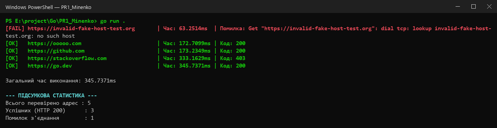
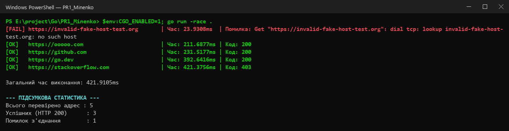
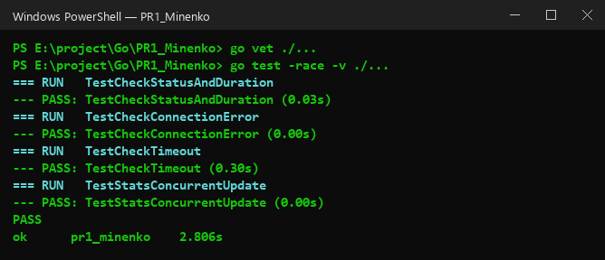

# Практична робота № 1
## Тема: Базові конструкції, структури даних та конкурентність у Go
### (Реалізація: Рівень 1 та Рівень 2)

---

## Зміст
1. [Мета роботи](#мета-роботи)
2. [Опис реалізованої системи (Рівні 1 та 2)](#опис-реалізованої-системи-рівні-1-та-2)
3. [Структура проєкту](#структура-проєкту)
4. [Покрокова інструкція із запуску](#покрокова-інструкція-із-запуску)
5. [Скріншоти роботи програми](#скріншоти-роботи-програми)
6. [Відповіді на контрольні питання](#відповіді-на-контрольні-питання)
7. [Висновок](#висновок)

---

## Мета роботи
- Набути практичних навичок роботи з системою типів Go: структурами (`struct`), методами з одержувачами (`receiver`), явним опрацюванням помилок (`error`).
- Опанувати проєктування інтерфейсів (`interface`) та їхню неявну імплементацію.
- Засвоїти модель конкурентності Go: запуск горутин, синхронізацію через `sync.WaitGroup` та взаємне виключення `sync.Mutex`.

---

## Опис реалізованої системи (Рівні 1 та 2)

Розроблено консольну утиліту **моніторингу доступності мережевих ресурсів (HTTP URL Health Checker)**.

1. **Рівень 1 (Базовий: структури, методи, інтерфейс)**:
   - Ініціалізовано Go-модуль `pr1_minenko`, код розміщено у файлі `main.go`.
   - Структура результату `healthCheck`: URL-адреса (`url string`), HTTP-статус (`http int`), тривалість запиту (`time time.Duration`), помилка з'єднання (`err error`).
   - Інтерфейс `checkOperation` з методом `check(url string) healthCheck` абстрагує операцію перевірки.
   - Структура `httpCheck` містить внутрішній `*http.Client` з таймаутом; конструктор `newHTTPCheck(timeout)` налаштовує таймаут 5 секунд.
   - Метод `(*httpCheck).check` виконує `client.Get(url)`, вимірює тривалість через `time.Now()` / `time.Since()`, закриває тіло відповіді (`defer resp.Body.Close()`) та повертає результат або помилку.
   - `httpCheck` задовольняє інтерфейс неявно: змінна оголошена як `var checker checkOperation = newHTTPCheck(...)`.
   - У `main()` сформовано зріз із 5 адрес: реальні сайти (`https://go.dev`, `https://github.com`, `https://stackoverflow.com`, `https://ooooo.com`) та завідомо неіснуючий домен `https://invalid-fake-host-test.org` для перевірки обробки помилок.

2. **Рівень 2 (Конкурентний: горутини, WaitGroup, Mutex)**:
   - Послідовний цикл замінено запуском перевірки кожного URL в окремій горутині (`go func(targetURL string) {...}(u)`); поточна адреса передається аргументом, тому замикання змінної циклу не виникає.
   - `sync.WaitGroup`: `wg.Add(1)` викликається до оператора `go`, `defer wg.Done()` — всередині горутини, `wg.Wait()` блокує `main()` до завершення всіх перевірок.
   - Спільна структура статистики `stats` (усього перевірено, успішних зі статусом 200, помилок з'єднання) захищена `sync.Mutex`; метод `update()` змінює лічильники під `Lock()` / `defer Unlock()`.
   - Вимірюється та виводиться загальний час конкурентного опитування.
   - Відсутність стану гонитви підтверджено запуском `go run -race .` та `go test -race`.
   - Написано автоматичні тести (`main_test.go`) на локальних серверах `httptest`: коди 200 і 404, вимірювання тривалості, помилка з'єднання, таймаут клієнта та одночасне оновлення статистики з 300 горутин.

---

## Структура проєкту

```text
PR1_Minenko/
├── main.go        # Структури healthCheck, httpCheck, stats; інтерфейс checkOperation; main()
├── main_test.go   # Автоматичні тести
├── png/           # Скріншоти для звіту
├── go.mod         # Go-модуль pr1_minenko
└── README.md      # Звіт
```

---

## Покрокова інструкція із запуску

### Крок 1. Запуск програми
```powershell
go run .
```
Приклад виводу:
```text
[FAIL] https://invalid-fake-host-test.org       | Час: 63.2514ms  | Помилка: Get "https://invalid-fake-host-test.org": dial tcp: lookup invalid-fake-host-test.org: no such host
[OK]   https://ooooo.com                        | Час: 172.7099ms | Код: 200
[OK]   https://github.com                       | Час: 173.2349ms | Код: 200
[OK]   https://stackoverflow.com                | Час: 333.1629ms | Код: 403
[OK]   https://go.dev                           | Час: 345.7371ms | Код: 200

Загальний час виконання: 345.7371ms

--- ПІДСУМКОВА СТАТИСТИКА ---
Всього перевірено адрес : 5
Успішних (HTTP 200)      : 3
Помилок з'єднання        : 1
```
Порядок рядків змінюється від запуску до запуску: результати виводяться в порядку завершення горутин. Загальний час дорівнює часу найповільнішого запиту, а не сумі всіх запитів. Сайт `stackoverflow.com` відповідає `403` на запити без браузерних заголовків: з'єднання успішне, але статус не `200`, тому він не входить до лічильника `Успішних (HTTP 200)`.

### Крок 2. Перевірка на стан гонитви
```powershell
$env:CGO_ENABLED=1; go run -race .
```
Детектор гонитви потребує C-компілятора. У Windows підходить `gcc` з MSYS2 (`C:\msys64\ucrt64\bin` має бути в `PATH`). У виводі не повинно бути попереджень `WARNING: DATA RACE`.

### Крок 3. Статичний аналіз та автоматичні тести
```powershell
go vet ./...
go test -race -v ./...
```

---

## Скріншоти роботи програми

| № | Файл | Що показано |
|---|------|-------------|
| 1 | `1_run.png` | `go run .` — результати перевірки адрес, загальний час, підсумкова статистика |
| 2 | `2_race.png` | `go run -race .` — та сама робота без попереджень `DATA RACE` |
| 3 | `3_go_test_passed.png` | `go vet` та `go test -race -v` без помилок |

#### 1. Конкурентна перевірка адрес


#### 2. Перевірка детектором гонитви


#### 3. Автоматичні тести


---

## Відповіді на контрольні питання

### 1. Неявна реалізація інтерфейсів у Go та `implements` у Java/C#
У Java та C# клас має явно оголосити `implements Interface`, тобто зв'язок між типом та інтерфейсом фіксується в момент написання класу, а тип із чужої бібліотеки не можна «підключити» до свого інтерфейсу. У Go тип задовольняє інтерфейс автоматично, якщо має всі його методи з потрібними сигнатурами. Перевірка виконується компілятором у місці присвоєння (`var checker checkOperation = newHTTPCheck(...)`). Завдяки цьому інтерфейси оголошують там, де їх використовують, вони зазвичай маленькі (1–2 методи), а будь-який існуючий тип можна підставити замість інтерфейсу, зокрема тестову заглушку.

### 2. Value receiver та pointer receiver
- **Value receiver** (`func (b Bot) Greet()`) — метод отримує копію значення. Зміни полів усередині методу не впливають на оригінал; для великих структур кожен виклик копіює всі дані.
- **Pointer receiver** (`func (h *httpCheck) check()`) — метод отримує адресу. Можна змінювати поля оригіналу, копіювання немає. Потрібен для структур, які містять `sync.Mutex` (м'ютекс не можна копіювати), тому `stats.update` має pointer receiver.
Набір методів типу `T` містить лише value-методи, а `*T` — обидва види. Тому інтерфейс із pointer-методом задовольняє лише вказівник (`*httpCheck`).

### 3. Чому 1000 горутин не вичерпують пам'ять, на відміну від потоків ОС
Потік ОС резервує стек фіксованого розміру (зазвичай 1–8 МБ), а його створення та перемикання вимагають системних викликів і роботи ядра. 1000 потоків означають гігабайти зарезервованої пам'яті та дорогі перемикання контексту. Горутина стартує зі стеком близько 2 КБ, який росте й зменшується динамічно. Нею керує планувальник середовища Go (модель GMP): тисячі горутин (G) мультиплексуються на невелику кількість потоків ОС (M) через логічні процесори (P), а перемикання відбувається в просторі користувача. Горутина, що чекає на мережу, не блокує потік: мережевий поллер паркує її і віддає потік іншим.

### 4. Стан гонитви та прапорець `-race`
Стан гонитви (data race) виникає, коли дві або більше горутин одночасно звертаються до однієї змінної, принаймні одна з них записує, і доступ не впорядкований синхронізацією. Результат стає непередбачуваним: наприклад, операція `s.totalChecks++` складається з читання, збільшення та запису, тому частина інкрементів губиться. Прапорець `-race` компілює програму з інструментацією кожного звернення до пам'яті (ThreadSanitizer): середовище відстежує, які горутини і в якому порядку працювали з кожною адресою, і при виявленні несинхронізованого доступу друкує `WARNING: DATA RACE` зі стеками обох звернень. Детектор знаходить лише ті гонитви, які реально відбулися під час запуску.

### 5. Призначення `sync.WaitGroup` і чому `Add()` викликається до `go`
`sync.WaitGroup` — лічильник активних задач: `Add(n)` збільшує його, `Done()` зменшує, `Wait()` блокує, доки лічильник не стане нулем. Без нього `main()` завершився б раніше за горутини, і процес зупинився б разом з ними. `Add()` має бути викликаний до `go`, бо момент старту горутини не визначений: якщо викликати `Add(1)` всередині горутини, `main()` може дійти до `Wait()`, коли лічильник ще дорівнює нулю, і завершитися, не дочекавшись роботи.

### 6. `sync.Mutex` та передача володіння через `chan`
**Mutex** захищає спільну пам'ять: кілька горутин працюють з одними даними, але по черзі (`Lock` / `Unlock`). Це просто для невеликої критичної секції (лічильники статистики), але легко помилитися: забути розблокувати, захопити м'ютекси в різному порядку і отримати взаємне блокування.
**Канал** передає дані від однієї горутини іншій: після відправлення значення ним володіє отримувач, спільного стану немає («діліться пам'яттю, спілкуючись»). Канал одночасно синхронізує та передає дані, добре описує конвеєри та «виробник — споживач», а закриття каналу сигналізує про завершення потоку даних.

### 7. Відправлення в закритий канал та повторне закриття
І відправлення значення в закритий канал, і повторний виклик `close()` для вже закритого каналу спричиняють паніку (`send on closed channel`, `close of closed channel`). Закриття `nil`-каналу теж панікує. Читання із закритого каналу не панікує: спочатку повертаються залишки з буфера, потім нульове значення типу, а форма `v, ok := <-ch` повертає `ok == false`. Тому канал закриває лише відправник, і робить це один раз, коли всі відправлення завершено (наприклад, окрема горутина після `wg.Wait()`).

---

## Висновок
Під час виконання практичної роботи № 1 (Рівні 1 та 2):
1. Змодельовано результат перевірки адреси структурою `healthCheck` з явним полем помилки `error`.
2. Спроєктовано інтерфейс `checkOperation` та його неявну реалізацію структурою `httpCheck` з власним `http.Client` і таймаутом.
3. Реалізовано точний замір тривалості кожного запиту через `time.Now()` / `time.Since()`.
4. Перевірку адрес розпаралелено горутинами з коректною передачею змінної циклу та очікуванням через `sync.WaitGroup`.
5. Спільну статистику захищено `sync.Mutex`, що усуває стан гонитви під час одночасного оновлення лічильників.
6. Загальний час конкурентної перевірки дорівнює часу найповільнішого запиту, а не сумі тривалостей усіх запитів.
7. Коректність підтверджено автоматичними тестами та запуском із детектором гонитви `-race`.
